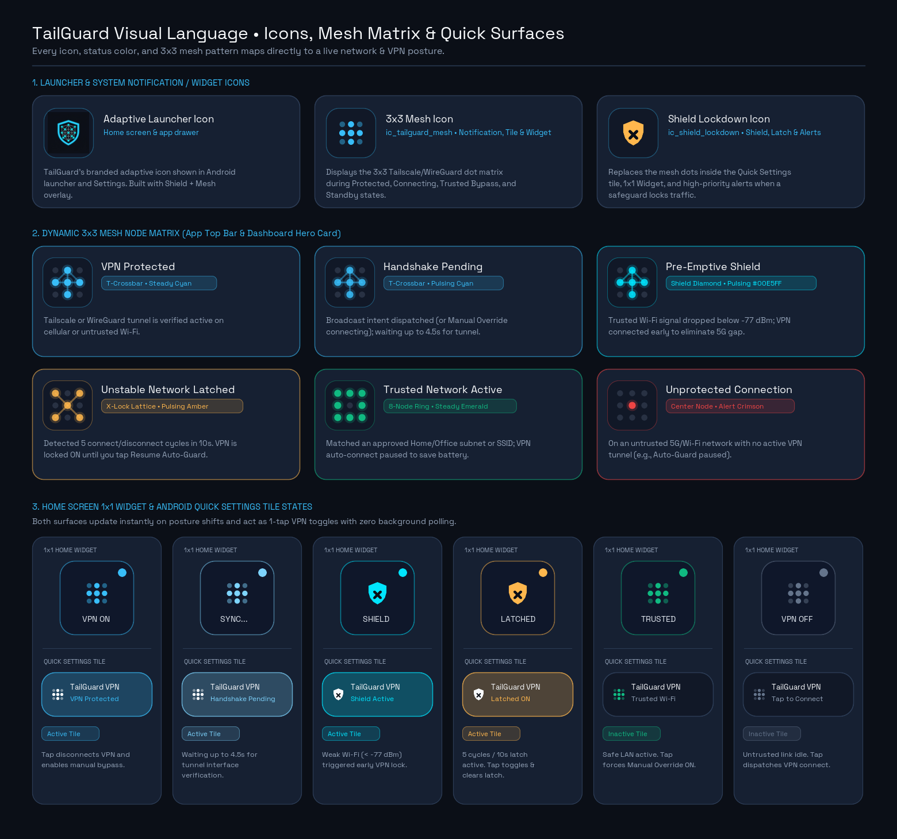
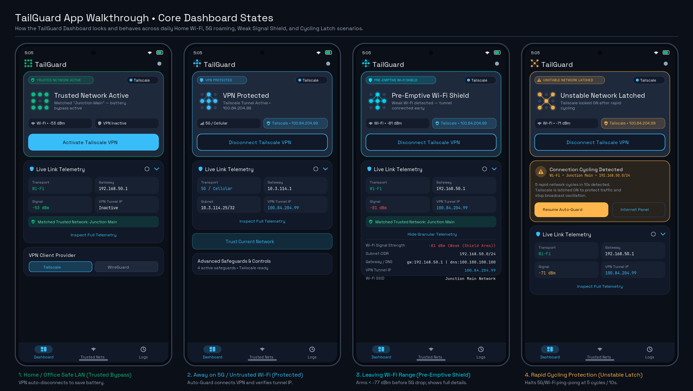
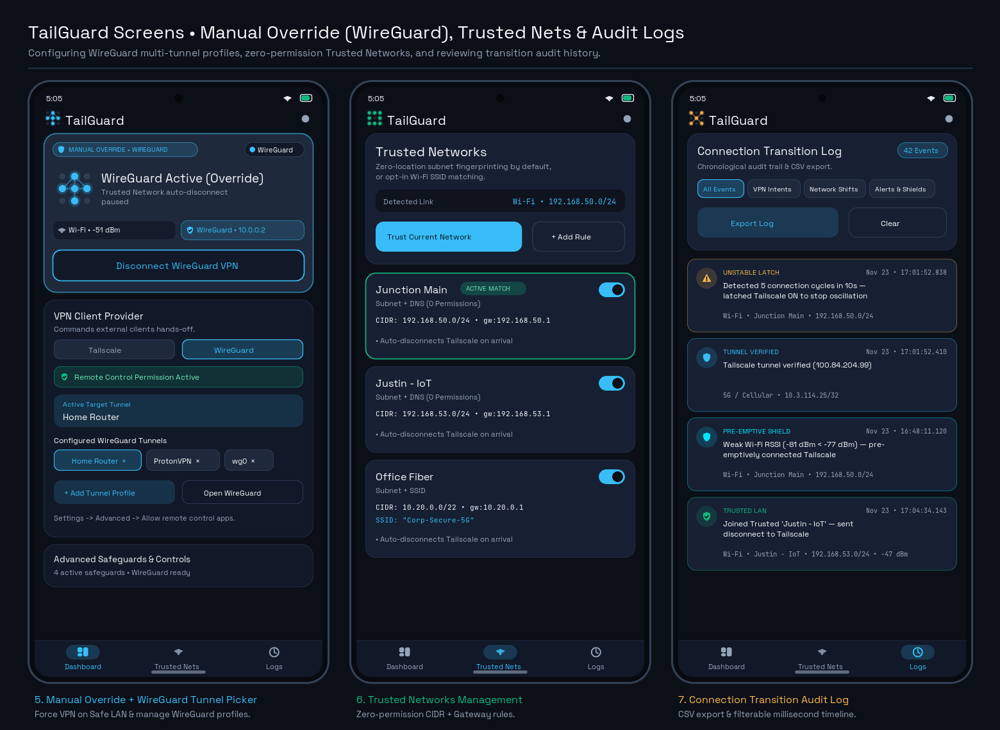
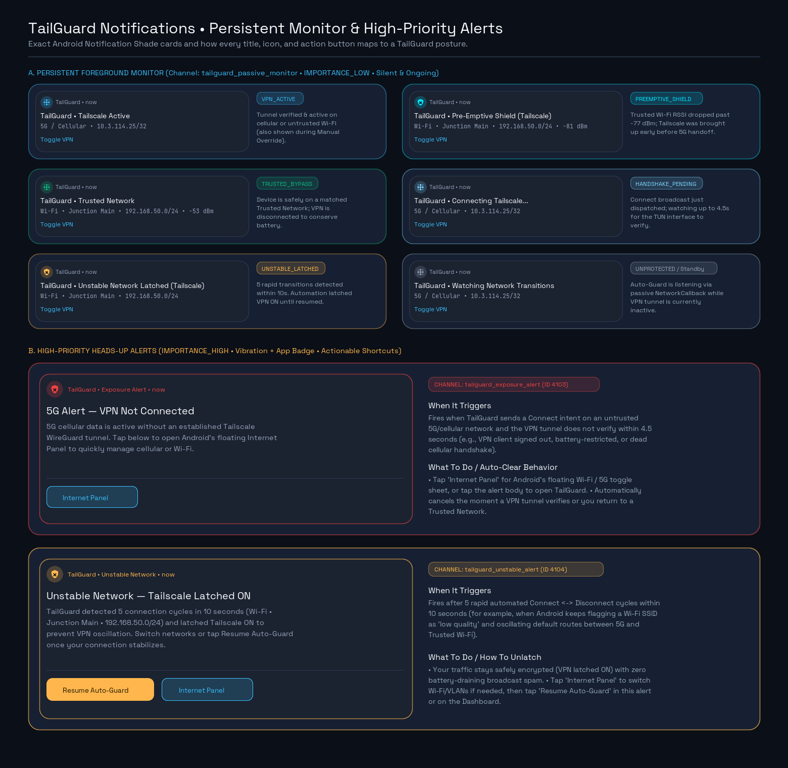

# TailGuard Visual User Guide & State Reference

Welcome to **TailGuard**. This visual guide walks through every icon, app screen, network posture, Quick Settings tile, widget badge, and Android notification you will see in real-world use—without needing to recreate weak-Wi-Fi handoffs, 5G timeouts, or rapid connection cycling on your phone first.

---

## Table of Contents
1. [App Icons, 3×3 Mesh Matrix & Quick Surfaces](#1-app-icons-33-mesh-matrix--quick-surfaces)
2. [Full App Walkthrough: Core Dashboard States](#2-full-app-walkthrough-core-dashboard-states)
3. [WireGuard Mode, Trusted Networks & Transition Audit Logs](#3-wireguard-mode-trusted-networks--transition-audit-logs)
4. [Persistent Foreground Notification & High-Priority Alerts](#4-persistent-foreground-notification--high-priority-alerts)

---

## 1. App Icons, 3×3 Mesh Matrix & Quick Surfaces

### Launcher & System Drawable Icons
| Icon | Where It Appears | Meaning |
| :--- | :--- | :--- |
| **Adaptive Launcher Icon** | Android Home Screen & App Drawer | Branded Shield + 3×3 Mesh badge identifying the TailGuard app. |
| **3×3 Mesh Icon** (`ic_tailguard_mesh`) | Ongoing monitor notification, Quick Settings tile, 1×1 Home Widget | Standard active/standby icon used when TailGuard is in **Protected**, **Connecting**, **Trusted Bypass**, or **Standby** mode. |
| **Shield Lockdown Icon** (`ic_shield_lockdown`) | Quick Settings tile, 1×1 Home Widget, High-Priority Alerts | Appears when a safeguard actively holds protection (**Pre-Emptive Shield**, **Unstable Network Latch**, or **5G Exposure Alert**). |

### Dynamic 3×3 Mesh Node Matrix (Top App Bar & Hero Card)
The 3×3 dot matrix inside the top bar and Dashboard Hero card animates its pattern and color in real time based on TailGuard's active `VpnPosture`:

| Visual Pattern | Color | Posture State | What Is Happening |
| :--- | :--- | :--- | :--- |
| **T-Crossbar (Steady)** | Electric Cyan (`#38BDF8`) | **VPN Protected** | Tailscale or WireGuard tunnel is verified active over cellular or untrusted Wi-Fi. |
| **T-Crossbar (Pulsing)** | Electric Cyan (`#38BDF8`) | **Handshake Pending** | A connect broadcast was sent (or Manual Override is starting); TailGuard is verifying the tunnel for up to 4.5s. |
| **Shield Diamond (Pulsing)** | Bright Cyan (`#00E5FF`) | **Pre-Emptive Wi-Fi Shield** | Trusted Wi-Fi RSSI dropped below `-77 dBm`; TailGuard connected your VPN early to prevent a 5G exposure gap. |
| **X-Lock Lattice (Pulsing)** | Amber (`#F59E0B` / `#FFB74D`) | **Unstable Network Latched** | Detected **5 rapid connect/disconnect cycles in 10s**; VPN is locked **ON** and automation is latched until you resume. |
| **8-Node Outer Ring** | Signal Emerald (`#10B981`) | **Trusted Network Active** | Connected to an approved Home/Office subnet or SSID; VPN auto-connect is paused to conserve battery. |
| **Single Center Node** | Alert Crimson (`#EF4444`) | **Unprotected Connection** | On an untrusted network (5G or public Wi-Fi) with no active VPN tunnel (for example, when Auto-Guard is paused). |

### Home Screen 1×1 Widget & Android Quick Settings Tile
Both external surfaces support **1-tap VPN toggling** with zero periodic background polling:

| 1×1 Widget Label | Quick Settings Subtitle | Tile State | Tap Action |
| :--- | :--- | :--- | :--- |
| `VPN ON` | `VPN Protected` | Active | Sends disconnect broadcast and enables manual bypass. |
| `SYNC...` | `Handshake Pending` | Active | Cancels pending handshake / disconnects active override. |
| `SHIELD` | `Shield Active` | Active | Stands down Pre-Emptive Shield and disconnects VPN. |
| `LATCHED` | `Latched ON` | Active | Clears the unstable-network latch and toggles VPN. |
| `TRUSTED` | `Trusted Wi-Fi` | Inactive | Forces **Manual Override ON** while staying on Trusted Wi-Fi. |
| `VPN OFF` | `Tap to Connect` | Inactive | Immediately dispatches a VPN connect broadcast. |

---

## 2. Full App Walkthrough: Core Dashboard States

### State 1 — Home / Office Safe LAN (`Trusted Network Active`)
- **When you see it:** You are connected to a verified Trusted Network (e.g., `Junction Main` on `192.168.50.0/24` with healthy signal `-53 dBm`).
- **What TailGuard does:** Automatically disconnects Tailscale/WireGuard upon arrival (when *Auto-Disconnect on Trusted Wi-Fi* is enabled) so your phone avoids unnecessary VPN overhead on your safe home LAN.
- **Dashboard highlights:** Emerald **TRUSTED NETWORK ACTIVE** hero card, 8-node Emerald ring, `Matched Trusted Network: Junction Main` badge inside **Live Link Telemetry**, and an **Activate Tailscale VPN** button if you want Manual Override.

### State 2 — Away on 5G / Untrusted Wi-Fi (`VPN Protected`)
- **When you see it:** You leave home Wi-Fi or join a public/unknown Wi-Fi network.
- **What TailGuard does:** Android's passive `NetworkCallback` fires immediately, TailGuard dispatches the connect broadcast, verifies the kernel tunnel IP (e.g., `100.84.204.99`), and updates the UI.
- **Dashboard highlights:** Electric Cyan **VPN PROTECTED** badge, T-crossbar Cyan mesh, active tunnel pill (`Tailscale • 100.84.204.99`), and a quick **Trust Current Network** CTA if you are on a new Wi-Fi network you want to whitelist.

### State 3 — Leaving Wi-Fi Range (`Pre-Emptive Wi-Fi Shield`)
- **When you see it:** Your Trusted Wi-Fi signal weakens below **`-77 dBm`** (for example `-81 dBm` while walking out to your driveway or garage) for 1.5 seconds.
- **What TailGuard does:** Connects your VPN *before* Wi-Fi completely drops so your phone never leaks unencrypted packets during the Wi-Fi → 5G handoff. Auto-disconnect is suppressed with hysteresis until signal recovers above `-71 dBm`.
- **Dashboard highlights:** Bright Cyan `#00E5FF` **PRE-EMPTIVE WI-FI SHIELD** card and red weak-signal indicator (`-81 dBm (Weak (Shield Arms))`) inside the expanded **Live Link Telemetry** inspector.

### State 4 — Rapid Cycling Protection (`Unstable Network Latched`)
- **When you see it:** Your phone rapidly oscillates between networks (such as Android marking a Wi-Fi SSID as "low quality" and bouncing default routes back and forth with 5G) triggering **5 connection cycles within 10 seconds**.
- **What TailGuard does:** Immediately halts connect/disconnect broadcast ping-pong, **locks your VPN ON** so traffic stays encrypted, logs `UNSTABLE_NETWORK_LATCHED`, and fires a high-priority notification.
- **Dashboard highlights:** Amber **UNSTABLE NETWORK LATCHED** hero posture and the dedicated **Connection Cycling Detected** warning banner right below it with two 1-tap actions:
  - **`Resume Auto-Guard`**: Clears the latch and re-evaluates your current stabilized connection.
  - **`Internet Panel`**: Opens Android's floating Wi-Fi / 5G switcher so you can inspect or switch SSIDs/VLANs.

---

## 3. WireGuard Mode, Trusted Networks & Transition Audit Logs

### Screen 5 — Manual Override + WireGuard Multi-Tunnel Picker
- **Manual Override Mode:** Tapping **Activate VPN** while on a Trusted Wi-Fi network switches the Hero card into **Manual Override** (`Trusted Network auto-disconnect paused`), keeping your VPN tunnel alive at home for remote admin or homelab routing until you tap **Disconnect**.
- **WireGuard Client Provider:** Selecting **WireGuard** reveals a runtime `CONTROL_TUNNELS` permission check card, **Active Target Tunnel** indicator, selectable/deletable tunnel profile chips (`Home Router`, `ProtonVPN`, `wg0`), **+ Add Tunnel Profile** dialog, and a direct **Open WireGuard** shortcut.
- **Advanced Safeguards & Controls:** Collapsible panel housing toggles for *Auto-Connect on Untrusted Networks*, *Pre-Emptive Wi-Fi Disconnect Connect*, *5G Exposure Warning & 1-Tap Panel*, *Auto-Disconnect on Trusted Wi-Fi*, plus diagnostic broadcast testing and System Always-On VPN settings.

### Screen 6 — Trusted Networks Tab (`Trusted Nets`)
- **Zero-Permission Subnet Fingerprinting:** Defaults to matching your router's **IPv4/IPv6 Subnet CIDR + Gateway IP** (`192.168.50.0/24 • gw:192.168.50.1`), which survives Tailscale MagicDNS / Exit Node DNS changes and requires **zero Android Location permissions**.
- **Optional SSID Matching:** You can also choose **Wi-Fi SSID** or **Subnet + SSID** mode (Android requires granting Location permission to read Wi-Fi SSIDs).
- **Per-Network Controls:** Each rule card displays an **`ACTIVE MATCH`** badge when currently matched, an enable/disable toggle, and edit/delete controls.

### Screen 7 — Connection Transition Audit Log (`Logs`)
- **Chronological Millisecond Trail:** Records every network shift, VPN broadcast intent, tunnel verification, pre-emptive shield, exposure alert, and unstable latch event with timestamps (`MMM dd • HH:mm:ss.SSS`).
- **Quick Filters:** Filter instantaneously across **All Events**, **VPN Intents**, **Network Shifts**, and **Alerts & Shields**.
- **Export & Troubleshooting:** Tap **Export Log** to share a clean CSV audit log (`timestamp,event_type,network,action_summary`) via Android's share sheet.

---

## 4. Persistent Foreground Notification & High-Priority Alerts

### A. Persistent Foreground Monitor (`tailguard_passive_monitor`)
When **Auto-Connect on Untrusted Networks** is enabled, TailGuard runs a zero-polling, silent `IMPORTANCE_LOW` foreground service so Android never kills the passive `NetworkCallback` listener. Every line of this persistent notification maps directly to a live state:

| Notification Title | Example Body Line | Related Posture | What It Tells You |
| :--- | :--- | :--- | :--- |
| `TailGuard • <Provider> Active` | `5G / Cellular • 10.3.114.25/32` | `VPN_ACTIVE` | Tunnel is verified and actively protecting traffic (including during Manual Override). |
| `TailGuard • Pre-Emptive Shield (<Provider>)` | `Wi-Fi • Junction Main • 192.168.50.0/24 • -81 dBm` | `PREEMPTIVE_SHIELD` | Weak Wi-Fi (`< -77 dBm`) triggered early VPN connection before cellular failover. |
| `TailGuard • Trusted Network` | `Wi-Fi • Junction Main • 192.168.50.0/24 • -53 dBm` | `TRUSTED_BYPASS` | Safe LAN matched; VPN is paused to save battery. |
| `TailGuard • Connecting <Provider>...` | `5G / Cellular • 10.3.114.25/32` | `HANDSHAKE_PENDING` | Connect broadcast sent; awaiting TUN interface confirmation. |
| `TailGuard • Unstable Network Latched (<Provider>)` | `Wi-Fi • Junction Main • 192.168.50.0/24` | `UNSTABLE_LATCHED` | 5 rapid cycles in 10s detected; VPN locked ON until resumed. |
| `TailGuard • Watching Network Transitions` | `5G / Cellular • 10.3.114.25/32` | `UNPROTECTED` | Passive monitor standing by while VPN tunnel is currently inactive. |

Every persistent notification also includes a **`Toggle VPN`** quick action button for one-tap manual control directly from your notification shade.

---

### B. High-Priority Heads-Up Alerts (`IMPORTANCE_HIGH`)

#### 1. 5G Exposure Alert (`tailguard_exposure_alert` • Notification ID `4103`)
- **Title:** `5G Alert — VPN Not Connected`
- **When it triggers:** TailGuard dispatched a connect broadcast on an untrusted cellular network, but no active VPN tunnel interface verified within **4.5 seconds** (for instance, if the VPN client app is signed out or restricted by battery optimization).
- **Actions & Auto-Clear:** Includes an **`Internet Panel`** action button to quickly toggle mobile data or Wi-Fi, and automatically clears as soon as a VPN tunnel connects or you join a Trusted Network.

#### 2. Unstable Network Cycling Alert (`tailguard_unstable_alert` • Notification ID `4104`)
- **Title:** `Unstable Network — <Provider> Latched ON`
- **When it triggers:** TailGuard detects **5 automated Connect ↔ Disconnect cycles within 10 seconds** (such as Android bouncing between 5G and a "low quality" Wi-Fi network).
- **Actions & Recovery:**
  - Your VPN remains **safely latched ON** with no further oscillation broadcasts.
  - **`Resume Auto-Guard`**: 1-tap action right inside the notification to clear the latch and re-evaluate your connection once stable.
  - **`Internet Panel`**: Opens Android's floating connectivity sheet so you can switch Wi-Fi SSIDs/VLANs or toggle cellular.
